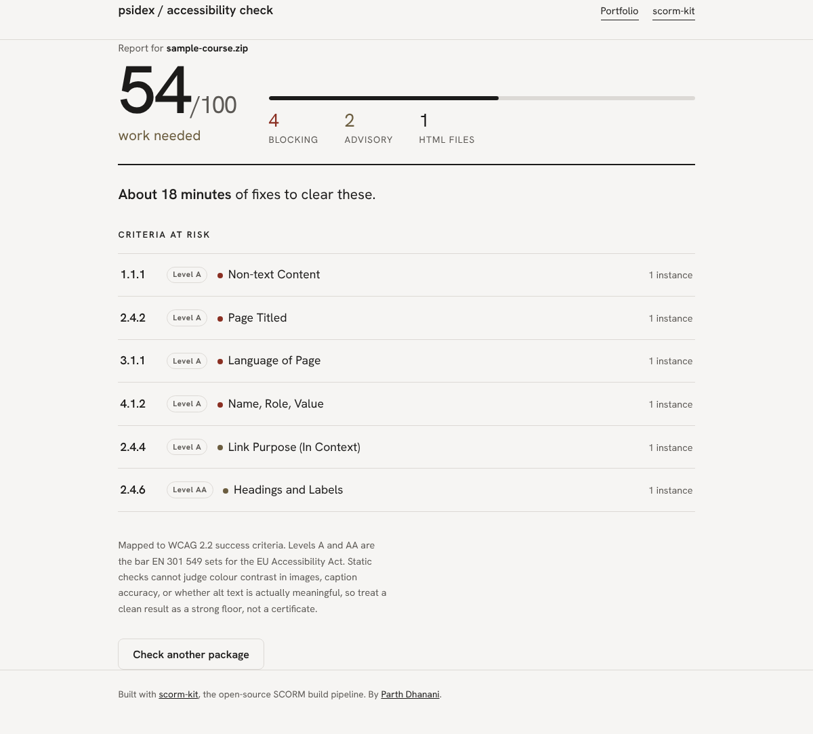

# EAA / WCAG Accessibility Checker for SCORM

[](https://github.com/parthdhanani/eaa-tool/actions/workflows/ci.yml)

Upload a SCORM package (`.zip`), get back a WCAG 2.2 conformance report: score, blocking vs advisory findings, and a plain-language fix for every issue — grouped by success criterion, with a rough remediation-time estimate.

Built for the [EU Accessibility Act](https://ec.europa.eu/social/main.jsp?catId=1202) (in force since June 2025), which points at EN 301 549 → WCAG 2.2 Level A/AA. Every rule this tool checks is mapped to a specific success criterion so a compliance report is traceable, not just a pass/fail badge.

## What it checks

Rules run through [scorm-kit](https://github.com/parthdhanani/scorm-kit)'s `a11y` engine and are mapped in [`wcag_map.py`](wcag_map.py) to WCAG criteria — missing `lang`/`title`, image alt-text problems (missing, filename-as-alt, redundant), missing video captions / audio transcripts, heading structure (skipped levels, missing `h1`), link and button naming, form labels, keyboard-operability of custom clickable elements, focus order, iframe titles, table headers, and ARIA validity.

## Screenshot

Report for a small synthetic SCORM package (the test fixture in `tests/fixtures/course/`), scanned with the real scorm-kit engine:



## Install

```bash
pip install -r requirements.txt
```

Requires Node.js and a checkout of [scorm-kit](https://github.com/parthdhanani/scorm-kit) — the tool shells out to its `a11y` command as the scanning engine. Point at it with env vars:

| Variable | Default | Purpose |
|---|---|---|
| `SCORM_KIT` | `~/AI_Space/complete/autonomous_lab/scorm-kit/bin/scorm-kit.js` | Path to the scorm-kit CLI |
| `NODE_BIN` | `node` | Node executable |
| `PORT` | `5051` | Dev server port |

## Usage

```bash
SCORM_KIT=/path/to/scorm-kit/bin/scorm-kit.js python app.py   # dev server on :5051
# or: gunicorn app:app --bind 0.0.0.0:5051
```

Open the page, drop a SCORM `.zip`, get a report: overall score, verdict (compliant / minor gaps / work needed / not compliant), and every finding grouped by WCAG success criterion with a plain-language fix.

The same report is available as JSON:

```bash
curl -s -F package=@course.zip http://localhost:5051/scan
# {"score": 54, "verdict": "work needed", "blocking": 4, "advisory": 2,
#  "files_scanned": 1, "remediation_minutes": 18, "criteria": [...]}
```

Scoring: start at 100, minus 10 per blocking (error) finding and 3 per advisory (warning), floored at 0. Verdict bands: ≥90 compliant, ≥70 minor gaps, ≥40 work needed, else not compliant.

## Testing

```bash
pip install -r requirements-dev.txt
ruff check .
python -m pytest -v
```

The suite is fully offline: `tests/fake_scorm_kit.py` stands in for the Node engine (its canned output is exactly what real scorm-kit reports for the fixture), so no Node or scorm-kit checkout is needed. To run the same scan against the real engine as well:

```bash
SCORM_KIT_REAL=/path/to/scorm-kit/bin/scorm-kit.js python -m pytest -v
```

CI (`.github/workflows/ci.yml`) runs ruff and the offline suite on every push and PR.

## Architecture

```
app.py          Flask app: upload -> session dir -> scorm-kit a11y (JSON + text pass) -> build_report -> JSON
wcag_map.py     rule id -> (WCAG SC, name, level, plain-language fix, minutes per occurrence)
templates/      single-page UI (drag-and-drop upload, report rendering)
tests/          pytest suite, synthetic fixture course, offline engine stub
```

`POST /scan` saves the upload into a per-request directory under `/tmp/eaa_tool_sessions`, checks size (80 MB) and zip magic bytes, runs the engine with a 60 s timeout, and always deletes the directory afterwards. A concurrency cap (15 live sessions) returns 503 when busy. Unmapped rules fall back to a generic 4.1.1 entry so a newer engine never breaks the report.

## Stack

Flask · Node.js (scorm-kit engine) · WCAG 2.2 / EN 301 549

## Deployment

Ships with a systemd unit (`eaa-tool.service`) behind gunicorn. Sessions are ephemeral — uploaded packages live under `/tmp` with a 15-minute TTL and are deleted immediately after scoring.
